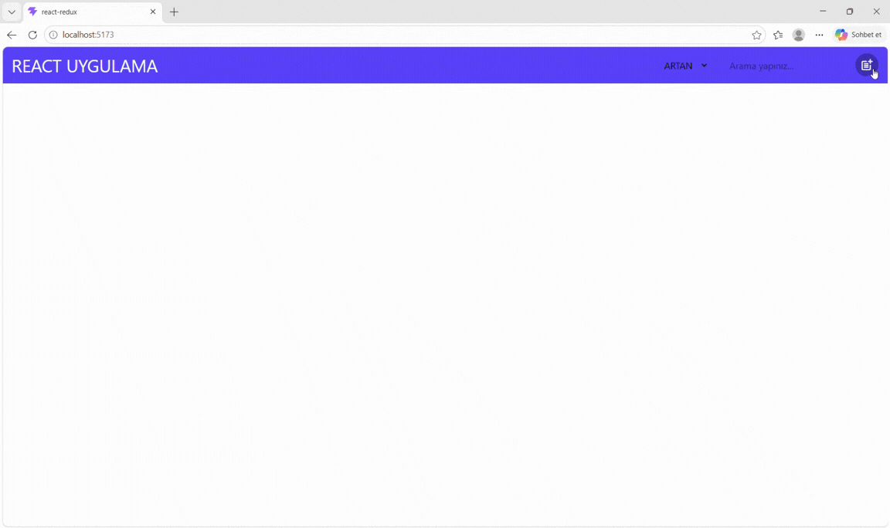

# 🛍️ Product Manager

A modern and responsive **Product Management Application** built with React and Redux Toolkit. It allows users to add, update, delete, search, and manage products through a user-friendly interface.

---

## 📌 Project Purpose

This project was developed to practice CRUD operations with React, centralized state management using Redux Toolkit, and navigation with React Router DOM.

### ✨ Key Features

- Add, update, and delete products (CRUD)
- Real-time product search and filtering
- Product sorting by price
- Product image upload and preview
- Centralized state management with Redux Toolkit
- Dynamic routing with React Router DOM
- Reusable and modular React components
- Modal-based product creation and editing
- Modern and responsive user interface

---

## 🛠️ Technologies Used

- **React** – Component-based user interface
- **Redux Toolkit** – State management
- **React Redux** – React and Redux integration
- **React Router DOM** – Dynamic routing
- **Tailwind CSS** – Responsive styling
- **Vite** – Fast development environment
- **JavaScript (ES6+)** – Application functionality
- **React Icons** – UI icons

---

## 🖥️ Project Preview

